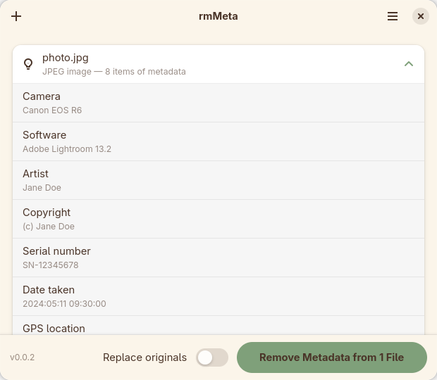

# rmMeta

Metadata within a file can tell a lot about you. Cameras record data about when and where a picture was taken and which camera was used. Office applications automatically add author and company information to documents and spreadsheets. This is sensitive information and you may not want to disclose it.

rmMeta shows you what is hidden in a file, then takes it out. For GNOME, written in Rust with GTK4 + Libadwaita.



## What it removes

| Format | Removed |
| --- | --- |
| JPEG | Exif, GPS coordinates, camera make/model and serial numbers, maker notes, XMP, IPTC/Photoshop, comments, the embedded thumbnail, and anything appended after the end of the image |
| PNG | `tEXt`/`zTXt`/`iTXt` text chunks, embedded Exif, modification timestamps, trailing data |
| GIF | Comment blocks, XMP, other application blocks, trailing data |
| WebP | `EXIF` and `XMP` chunks, and the `VP8X` header flags that announced them |
| TIFF and camera RAW<br>(CR2, NEF, ARW, DNG, ORF, RW2…) | GPS, artist, copyright, software, timestamps, camera and lens serial numbers (including DNG's), XMP, IPTC. Camera make and model are kept, and so are maker notes unless you choose otherwise — see below |
| HEIC / HEIF / AVIF | The Exif and XMP item payloads, overwritten in place |
| SVG | The `<metadata>` RDF block, the editor's `namedview`, `inkscape:`/`sodipodi:` attributes and elements, generator comments, and the metadata inside embedded pictures |
| .doc / .xls / .ppt | Author, last saved by, company, manager, template, revision count, editing time, timestamps and custom properties, zeroed in place; the user name Excel and PowerPoint record outside the properties |
| PDF | The whole information dictionary (author, title, creator, producer, dates), the XMP stream, the `/ID` file identifier, comment authors, application scratch data, the metadata inside embedded JPEG images, and objects left behind by earlier revisions |
| .docx / .xlsx / .pptx | Author, last saved by, company, manager, revision count, created/modified/printed dates, total editing time, template, authoring application, custom properties, the per-entry ZIP timestamps, and the metadata inside embedded pictures |
| .odt / .ods / .odp | The same, plus the generator string naming the exact office build and operating system |

What it deliberately leaves alone: image pixels (never re-encoded), ICC colour profiles, the Exif orientation tag — dropping it would make sideways photos display sideways — the names of the fields in a PDF form, and, in office documents, the title, subject, description and keywords you typed on purpose.

Encrypted PDFs are refused rather than cleaned: rewriting one would silently drop whatever restriction it carried.

Some formats cannot be cleaned completely without breaking them. Where that is so, the app says which parts it left and why, on a row marked **Kept:** — it never leaves something behind silently:

- **Camera RAW** keeps the camera make and model. A RAW converter picks its sensor profile from those, and a file without them can be rejected as an unknown camera. Location and the serial-number tags are removed.
- **Camera RAW** also keeps its maker notes by default. They are the camera maker's private block, and a converter may need them to decode the file or get its colours right — but they can hold the camera's serial number. Turn off **Keep Maker Notes in RAW Files** in the menu to remove them.
- **HEIC/HEIF/AVIF** keeps the (now empty) Exif and XMP item declarations. Their contents are overwritten with zeroes; removing the declarations themselves would mean relocating the image data.
- **.doc** keeps the "last saved by" list and any fast-save remnants buried in the Word document stream. The property values are overwritten.
- **Encrypted or Excel 5 .xls** keeps the user name Excel records in the workbook, which is out of reach in both.

Files are examined on your own computer. Nothing is uploaded anywhere.

## Using it

Drop files on the window or add them with the **+** button. Each file is examined straight away and lists what was found; a single file opens its list automatically. Then **Remove Metadata**.

With **Clean Automatically** switched on in the menu, dropped files are cleaned straight away, without the button. The list still shows what was removed from each one.

By default a cleaned copy is written beside the original (`holiday.jpg` → `holiday-clean.jpg`), so the original is never touched. The Flatpak only has access to the files you picked, not the folders around them, so it asks for a folder to put the copies in. Turn on **Replace originals** to overwrite in place; writes go through a temporary file and a rename, so an interrupted write cannot leave a half-written file behind. A file edited after you added it is examined again instead of being overwritten with the older version.

## Building

```sh
export CARGO_TARGET_DIR=/tmp/rmmeta-target   # the project dir is a virtiofs share
cargo build --release
cargo test
```

Needs `gtk4-devel` and `libadwaita-devel`.

`./makeflatpak.sh` builds a Flatpak bundle into `dist/` and installs nothing. It needs `flatpak-builder`, `org.gnome.Sdk//50` and `org.freedesktop.Sdk.Extension.rust-stable//25.08`, and tells you the exact command if any are missing.

`./bump.sh patch|minor|major [-m "note"]` is the only way the version changes.

## Licence

GPL-3.0-or-later. The full text is in [COPYING](COPYING).
